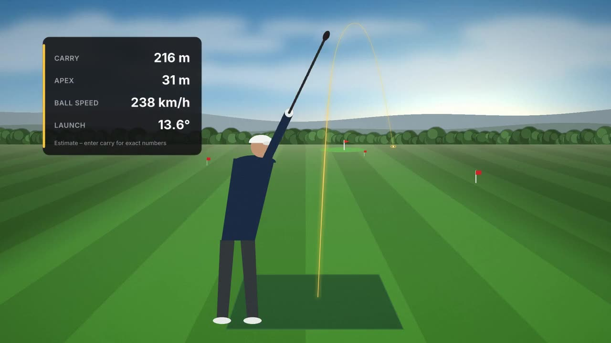

# Open Golf Tracer

A web editor for golf videos with an automatic, broadcast-style shot tracer. Upload a video and
the app finds every shot, draws the ball flight in 3D and lets you adjust it with handles that
refit the physics live. Add text, stat cards and templates, cut on the timeline, make slow-mo and
one short per shot, and export to Shorts, Reels, TikTok and YouTube – with HDR and audio kept.

Everything runs locally on your own machine. Your videos never leave it. Free and open source (MIT).



## Install on Windows (easiest)

1. Download **`OpenGolfTracer-Setup-<version>.exe`** from
   [Releases](https://github.com/nicklashn/open-golf-tracer/releases).
2. Double-click it. Windows may say *"Windows protected your PC"* because the installer is not
   signed – click **More info → Run anyway**. No admin rights are needed.
3. Start **Open Golf Tracer** from the Start menu or the desktop. The browser opens by itself;
   close the black window to stop the app.

Nothing else has to be installed and nothing is downloaded: Node.js, Python, FFmpeg and the ball
detector come with it. Your projects and
videos are kept in `%LOCALAPPDATA%\Programs\Open Golf Tracer\data`, also when you update.
Uninstall it under *Settings → Apps*; you are asked whether your projects should be deleted too.

**Make video for me** works out of the box without AI. To let an AI model help (optional), open
**Settings → AI** in the app, pick Ollama (runs on your own PC), an OpenAI-compatible service or
Anthropic, paste a key if the service needs one, and click **Test connection**.

To build the installer yourself: `powershell -ExecutionPolicy Bypass -File installer\build.ps1`
(needs Git and [Inno Setup 6](https://jrsoftware.org/isinfo.php): `winget install JRSoftware.InnoSetup`).
Pushing a `v*` tag builds it on GitHub Actions and attaches it to the release.

The steps below are for running from the source code.

## Requirements

- **Python 3.11+**
- **Node.js 20.11+**
- **FFmpeg** on your `PATH` (Windows: `winget install Gyan.FFmpeg`, macOS: `brew install ffmpeg`,
  Linux: `apt install ffmpeg`)
- A graphics card makes analysis and export faster, but is not required. On Windows the ball
  detector uses any GPU through DirectML (NVIDIA, AMD, Intel); no PyTorch or CUDA needed.

## Getting started

### Windows

1. Double-click **`setup.bat`**. It creates the Python environment, installs packages, downloads the
   ball detector (RF-DETR as ONNX, 120 MB), prepares the database and copies `.env.example` to `.env`.
2. Double-click **`start.bat`**. The first time (and after a `git pull`), the web app is built – about
   a minute. The browser then opens at <http://localhost:3000>.
3. Click **"Try a sample video"** or upload your own.

Close the window to stop the app.

### macOS / Linux

```
./setup.sh
npm run build && node scripts/dev.mjs --prod --open
```

Stop it with Ctrl+C. Run `npm run build` again after pulling new code.

Your data (database, videos, exports) lives in `data/`.

## No login – it only listens on this PC

Open Golf Tracer is for the person at the PC it runs on: there are no accounts, no sign-up and no
login. Open it and start. Because anyone who can reach the app can see and change every project,
it only listens on `127.0.0.1` by default, so other devices cannot reach it.

### Use it from another device on your network / a GPU PC

Want to edit from your laptop while a desktop with a big GPU does the work? Run the app on the
GPU PC and open it to your network in its `.env`:

```
LISTEN_HOST=0.0.0.0
```

Then open `http://<ip-of-that-pc>:3000` on the other device. Opening it by a name instead of an IP
(e.g. `http://mypc.local:3000`)? Add the name: `ALLOWED_HOSTS=mypc.local` (comma separated for
several). Other names are refused.

> **Warning:** there is still no login. Everyone on the network can see, change and delete all
> projects. Only do this on a network you trust (your home network) – never on public Wi-Fi or
> directly on the internet. The API itself always stays on `127.0.0.1`; the web app proxies to it.

## Configuration

Everything has sensible defaults, and nothing has to be set. To change something, edit `.env`
(setup copies it from [`.env.example`](.env.example), which explains every option):

| Variable | What it does |
|---|---|
| `DATA_DIR` | Where the database, videos and exports are stored (default `./data`) |
| `MAX_UPLOAD_BYTES`, `MAX_VIDEO_SECONDS` | Largest upload (default 20 GB) and longest video (default 2 hours) |
| `GOLF_DETECTOR` | Ball detector: `rfdetr` (default, ONNX), `rfdetr-torch`, `yolo` or `blob` |
| `GOLF_HDR_TONEMAP` | `1` tone-maps HDR videos to SDR before analysis |
| `PROXY_CODEC` | Editor preview codec: `h264` (default) or `vp9` |
| `INGEST_PARALLEL` | Videos prepared at once (preview, thumbnails, waveform); default 2, or 1 on PCs with 4 CPU cores or fewer |
| `EXPORT_CPU` | `1` forces CPU encoding even when a GPU encoder exists |
| `NEXT_PUBLIC_MAP_SATELLITE` | Satellite map in "Measure on map": empty = auto, `1` = always, `0` = never |
| `LISTEN_HOST`, `ALLOWED_HOSTS` | Network access, see above |
| `LOG_LEVEL` | `INFO` by default |
| `AI_PROVIDER`, `AI_MODEL`, `AI_BASE_URL`, `AI_API_KEY`, `AI_MAX_TOKENS` | Optional AI model for "Make video for me", see below |

Restart the app after changing `.env` (rebuild with `npm run build` after changing a
`NEXT_PUBLIC_` variable).

### AI for "Make video for me" (optional)

Everything works without AI. With a model it reads your preference, words the questions better and
writes the title, texts and an upload description. The model only sees **a text summary** of the
round (one line per clip and per shot), never video or images; at most 2 calls per video.

| Variable | Default | Meaning |
|---|---|---|
| `AI_PROVIDER` | `none` | `none` (fixed rules), `ollama` (local, nothing leaves the PC), `openai-compatible` (OpenAI, OpenRouter, LM Studio …) or `anthropic` |
| `AI_MODEL` | provider default | e.g. `llama3.1`, `gpt-4o-mini`, `claude-opus-5-5` |
| `AI_BASE_URL` | provider default | e.g. `http://localhost:11434/v1` (Ollama), `http://localhost:1234/v1` (LM Studio), `https://openrouter.ai/api/v1` |
| `AI_API_KEY` | – | Never sent to the browser, logged, or stored in projects or the data export |
| `AI_MAX_TOKENS` | `8000` | Token ceiling per video (in + out, all calls); above it the job stops with a clear error |

The same can be chosen in the app under **Settings → AI** (with "Test connection"); otherwise the
`.env` defaults are used. Token usage is shown when the video is done.

## Features

- **Analysis:** every shot in a video is found from the strike sound + ball detection (also without
  audio), the ball is tracked in flight and a physical trajectory is fitted. Progress is shown live.
- **Tracer editing:** drag the start, apex and landing; set club, carry, curve, flight time and timing.
  The physics refits in under 16 ms. Six styles + your own presets; the default looks like modern
  shot tracer clips (soft start, red to gold).
- **Hole and course from GPS:** the video's location is looked up in OpenStreetMap – course, hole, par
  and distance to the green. The distance keeps the estimate realistic (an approach shot can't become 250 m).
- **Measure on map:** the tee is taken from the video's GPS and the landing is suggested along the hole;
  click or drag, and the distance becomes the shot's carry. The hole can be shown as a graphic (course map).
- **Whole round:** pick several clips at once and they are merged into one project in the order they
  were filmed.
- **Make video:** one click gives a finished YouTube video (title, hole info, numbers, course map;
  vertical clips on a blurred background), one highlight short of all shots, or one short per shot –
  each as a new project.
- **Make video for me:** pick clips and write freely what you want ("YouTube video of the round, only
  good shots, calm style"). The app plans and cuts the video itself. When in doubt (uncertain flights,
  clips without shots or recording time, clips without GPS, possible retakes, the same shot from two
  angles) it asks once, with a default answer for every question. Works entirely without AI, or with an
  optional AI model (Ollama, OpenAI-compatible or Anthropic) that only sees a text summary; also from
  the command line (see below).
- **Graphics:** text, titles, stat cards, lower thirds, shapes, images/logos, with keyframes and
  in/out animations. Templates (Range session, Minimal, TV broadcast, Hole in one, Swing, Neon).
- **Timeline:** multiple tracks, trim, split, ripple, speed, freeze frame, audio and music.
- **Formats:** 16:9, 9:16, 1:1, 4:5 with automatic reframing that follows the ball, or the whole video
  on a blurred copy of itself.
- **Export:** presets for Shorts/Reels/TikTok, YouTube 1080p/4K and original; 30/60 fps; HDR kept or
  tone-mapped; queue with progress.
- **Settings:** language, units, theme and a data export of all your projects. Every feature is free.
- English and Danish, light and dark theme, keyboard shortcuts (`?` in the editor), WCAG AA.

## Licence

Open Golf Tracer is open source under the **MIT licence** – see [LICENSE](LICENSE). You may use,
modify, share and build on the code, commercially too. Contributions are welcome: see
[CONTRIBUTING.md](CONTRIBUTING.md). Third-party licences (including the ball detector – RF-DETR,
YOLO – and how to switch it): [docs/licensing.md](docs/licensing.md).

## Development

```
npm run dev          # API :8000, worker, exporter and web :3000 with hot reload
npm run check        # eslint + prettier + tsc + vitest
npm run test:py      # pytest (lint: .venv/bin/ruff check . && .venv/bin/pyright)
npx playwright test  # parity + e2e (needs the app running on :3000)
```

| Command | Purpose |
|---|---|
| `npm run autovideo -- <folder\|files> [--preference "…"] [--kind youtube\|highlight\|shorts] [--answers answers.json] [--yes] [--export youtube1080]` | "Make video for me" from the command line: uploads, waits for analysis, asks the questions (or `--yes` = default answers), makes the video and can export and download it. Needs the app running. |
| `npm run demo` | Draws the sample video and analyses it |
| `npm run brand` | Favicon, app icons and manifest from the vector sources |
| `npm run gen:schema` | JSON Schema from the zod schema (used by the API for validation) |
| `python scripts/make_static_fonts.py` | Static font versions for the renderer |

Python tests: `.venv/Scripts/python -m pytest` (slow tests with real video decoding: `-m slow`).
Put your own test videos in `videos/` – they are not committed.

How the parts fit together: [docs/architecture.md](docs/architecture.md) (in Danish for now).

## The engine on its own (without the web app)

The original command line still works. Drag one or more videos onto **`Tracer.bat`**, or:

```
.venv\Scripts\python -m shottracer VIDEO [VIDEO ...] [--carry M] [--club CLUB] [--stats] [--color #ffcc00] [--debug]
.venv\Scripts\python -m shottracer.analyze_video VIDEO --out shots.json   # analysis only, as JSON
```

| Option | Meaning |
|---|---|
| `-o PATH` | output file (one video) or output folder |
| `--carry M` | known carry in metres – scales the 3D flight so apex/ball speed fit |
| `--club CLUB` | `driver`, `wood`, `longIron`, `midIron`, `shortIron` or `wedge` – keeps the estimate realistic |
| `--stats` | shows carry / apex / ball speed / launch after landing |
| `--open` | shows the finished video in Explorer |
| `--color #ffcc00` | tracer colour |
| `--ball X,Y` | the ball's position at address, if it isn't found automatically |
| `--impact SEC` | time of impact, if it isn't found automatically |
| `--slowmo F` | the video is F times slower than real time |
| `--no-hold` | don't extend the video so the ball has time to land |
| `--debug` | saves `_debug.png` and `_debug.json` |

Filming tip: put the camera behind the ball (down-the-line) and keep it as still as possible.

The ball detector is RF-DETR Large, exported to ONNX and run with ONNX Runtime (DirectML on Windows,
CPU elsewhere). Setup downloads it to `models/rf-detr-large.onnx` (`python scripts/fetch_model.py`;
the Windows certificate store is used, so antivirus that intercepts HTTPS doesn't block the download).
On the reference clip it gives the same shots and numbers as RF-DETR in PyTorch, which is still
available as `GOLF_DETECTOR=rfdetr-torch` after `pip install -r requirements-torch.txt`
(`scripts/export_onnx.py` makes the ONNX file from it).
The YOLO detector can still be chosen with `GOLF_DETECTOR=yolo` or `--model yolo26x.pt` after
`pip install -r requirements-yolo.txt` (AGPL-3.0, see [docs/licensing.md](docs/licensing.md)).
